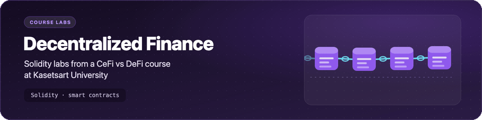
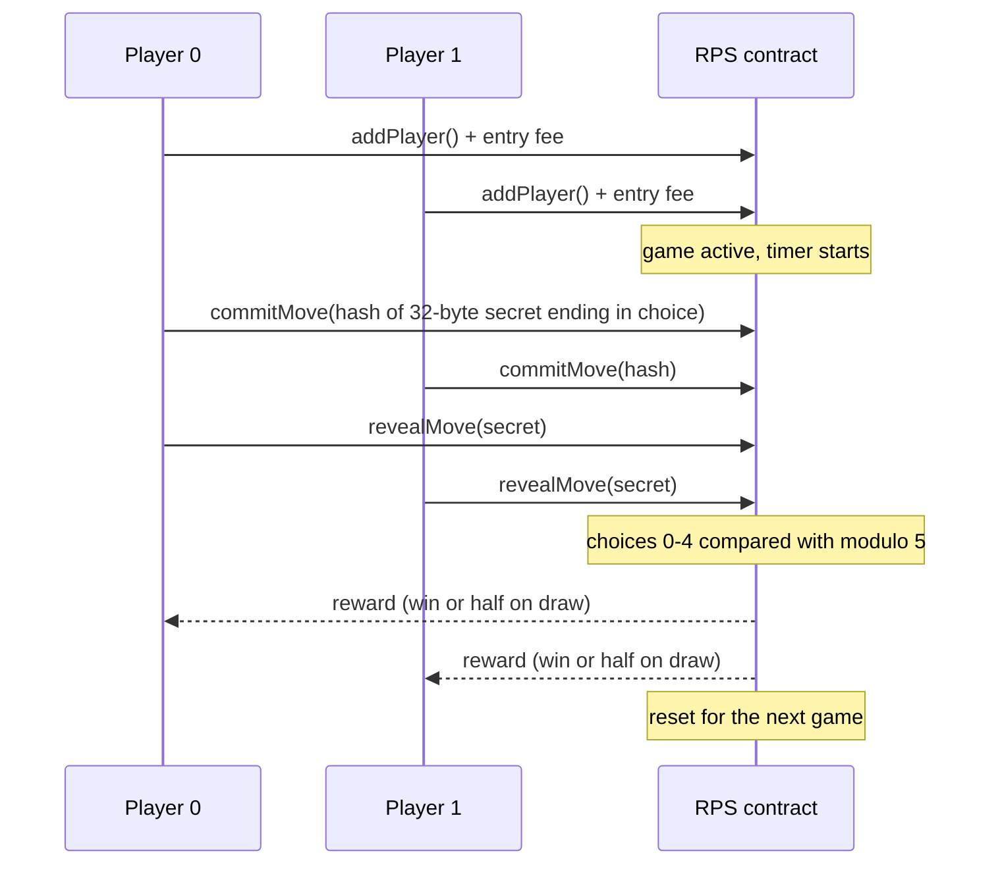

<p align="center">
  <picture>
    <source media="(prefers-reduced-motion: reduce) and (prefers-color-scheme: dark)" srcset="assets/banner-dark.svg">
    <source media="(prefers-reduced-motion: reduce)" srcset="assets/banner-light.svg">
    
  </picture>
</p>

<h1 align="center">Decentralized Finance</h1>

<p align="center">Solidity coursework from the CeFi vs DeFi special-topics course at Kasetsart University, including a commit-reveal Rock-Paper-Scissors-Lizard-Spock game.</p>

<p align="center">
  
  
  
</p>

Course: **วิชาปัญหาพิเศษ: โลกการเงินแบบรวมศูนย์กับแบบกระจายศูนย์ (CeFi vs DeFi)** (Special Problems: Centralized vs Decentralized Finance), Department of Computer Engineering, Kasetsart University. Lecturer: ภารุจ รัตนวรพันธุ์ (Paruj Ratanaworabhan).

## What's inside

- 🧱 **Solidity basics** (`contracts/basics/`): `HelloWorld`, `Counter` and `Primitives`, small warm-up contracts.
- 🔒 **Commit-reveal** (`contracts/CommitReveal.sol`): commit a hash, then reveal the value in a later block (within 250 blocks).
- ✊ **Lab 5, Rock-Paper-Scissors-Lizard-Spock** (`labs/lab5-smart-contract/RPS.sol`): two players pay a 1 ETH entry fee, hide their choices with commit-reveal, and the winner takes the pot (a draw splits it). Only four whitelisted Remix VM accounts may play, the contract resets after each payout, and there are withdraw functions for when no opponent joins or a move is not revealed within 5 minutes.
- 🪙 **ERC-20 version** (`contracts/Final_RPS.sol`): the same game paid in an ERC-20 token (set in the constructor) instead of ETH, open to any address.
- 📝 **Lab write-up in Thai** (`labs/lab5-smart-contract/README.md`): requirements and a walkthrough of each function.

## How the game works



Choices are `0` Rock, `1` Paper, `2` Scissors, `3` Spock, `4` Lizard. The secret is 31 random bytes followed by one choice byte; the lab write-up includes the short Python snippet used to build it, and `getHash()` gives the value to commit.

## Getting started

These contracts were written in [Remix IDE](https://remix.ethereum.org); no local toolchain is needed.

1. Open https://remix.ethereum.org and create a workspace.
2. Upload the `contracts/` and `labs/` folders (or connect the workspace to this GitHub repository).
3. Compile with Solidity 0.8.26 or a later 0.8.x compiler.
4. Deploy on the **Remix VM** environment. For `labs/lab5-smart-contract/RPS.sol`, play from the first four default Remix VM accounts, since only those may join.
5. For `contracts/Final_RPS.sol`, deploy an ERC-20 token first, pass its address to the constructor, and `approve` the RPS contract for the entry fee before `addPlayer()`.

<details>
<summary>Compile from the command line (optional)</summary>

With Node.js installed, the [solc-js](https://github.com/ethereum/solc-js) compiler checks that every contract builds:

```bash
npm install --no-save solc@0.8.26
for f in contracts/*.sol contracts/basics/*.sol labs/lab5-smart-contract/*.sol; do
  npx solcjs --bin --base-path . --include-path labs/lab5-smart-contract -o build "$f"
done
```

`build/` is ignored by Git.
</details>

## Project structure

```text
.
├── contracts/
│   ├── basics/              # HelloWorld, Counter, Primitives
│   ├── CommitReveal.sol     # commit-reveal pattern
│   └── Final_RPS.sol        # RPS paid in an ERC-20 token
├── labs/
│   └── lab5-smart-contract/
│       ├── README.md        # lab write-up (Thai)
│       ├── RPS.sol          # Rock-Paper-Scissors-Lizard-Spock with commit-reveal
│       ├── CommitReveal.sol
│       └── TimeUnit.sol
├── .editorconfig
├── .gitignore
└── README.md
```

## Credits

- `contracts/basics/` (`HelloWorld`, `Counter`, `Primitives`) follow the examples on [Solidity by Example](https://solidity-by-example.org) (MIT).
- `CommitReveal.sol` is based on Austin Griffith's [commit-reveal](https://github.com/austintgriffith/commit-reveal) example.
- `TimeUnit.sol` comes from [GeeksforGeeks: Time units in Solidity](https://www.geeksforgeeks.org/time-units-in-solidity/).
- The RPS contracts extend the starter code and requirements given in the course.

Each file keeps its original SPDX licence header. No repository-wide licence is set because part of the code comes from the sources above.

## About the course (ภาษาไทย)

วิชาปัญหาพิเศษ: โลกการเงินแบบรวมศูนย์กับแบบกระจายศูนย์ (CeFi vs DeFi) ภาควิชาวิศวกรรมคอมพิวเตอร์ มหาวิทยาลัยเกษตรศาสตร์ ผู้สอน ภารุจ รัตนวรพันธุ์

เนื้อหาครอบคลุม 3 ส่วน

- **CeFi:** การประเมินมูลค่าด้วย DCF ตลาดและทรัพย์สินทางการเงิน (หุ้น พันธบัตร forward/futures ออปชัน) ทฤษฎี portfolio, CAPM, Black-Scholes และปัญหาของการเงินแบบรวมศูนย์
- **Blockchain:** พื้นฐาน Bitcoin และ Ethereum, smart contract, Proof-of-Work กับ Proof-of-Stake
- **DeFi:** DEX (order book และ AMM), stablecoin, การกู้ยืมแบบกระจายศูนย์และ flash loan, oracle, decentralized identity, CBDC, DePIN, RWA tokenization

repository นี้เก็บโค้ด Solidity จากการเรียน รวมถึงปฏิบัติการที่ 5 เกมเป่ายิ้งฉุบแบบ Rock-Paper-Scissors-Lizard-Spock ที่ใช้ commit-reveal
